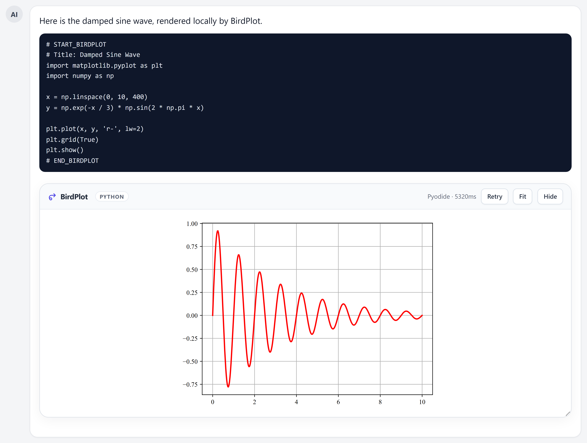
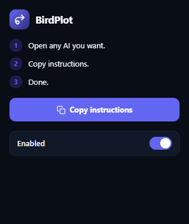
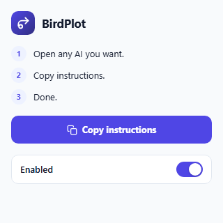

# BirdPlot

**See what AI means.** BirdPlot is a Manifest V3 browser extension that runs AI-written Python inside your chat and renders the result as a real, interactive visual - no API keys, no uploads, no external service.

[](manifest.json)
[](https://www.google.com/chrome/)
[](https://pyodide.org/)
[](tests)
[](manifest.json)



## What it does

AI assistants are good at writing Python and bad at showing you what it produced. BirdPlot watches supported chat pages for Python visualization code, detects the code blocks tagged with the BirdPlot markers, and executes them locally in a WebAssembly Python runtime. The chart, 3D scene, animation, or diagram is injected directly beneath the code block as an interactive card.

Everything runs on your machine. The only network traffic is the one-time download of the Python runtime files and any Python packages the generated code imports.

## Features

- Local Python execution through Pyodide 0.26.4 running in a Web Worker
- Renders Matplotlib figures as crisp SVG, animations as GIF, Plotly as interactive 2D/3D charts
- Supports 35 visualization, math, and science libraries, including NumPy, SciPy, SymPy, pandas, seaborn, Plotly, trimesh, shapely, networkx, and scikit-learn
- Automatic repair of common AI mistakes in generated code before execution
- Clear progress reporting while the engine starts, packages load, and code runs
- Watchdog protection: stuck or endless code fails with a visible error and a Retry button instead of hanging
- Rescale controls (Fit, 75%, 50%, 100%), a native resize handle, and light/dark themes matched to the host page
- A one-click extension toggle to disable rendering on any site

## Install

BirdPlot is installed as an unpacked extension. It is not yet published to the Chrome Web Store.

1. Download or clone this repository.
2. Open `chrome://extensions` in Chrome, Edge, Brave, or another Chromium browser.
3. Enable **Developer mode** in the top-right corner.
4. Click **Load unpacked** and select the folder that contains `manifest.json`.
5. Pin BirdPlot to the toolbar so the popup is one click away.

## Usage

1. Open any supported AI chat.
2. Click the BirdPlot icon and press **Copy instructions**, then paste the copied text into the chat once. The assistant now knows the output format BirdPlot expects.
3. Ask for a plot, diagram, 3D scene, or animation. The assistant replies with tagged Python, and BirdPlot renders it as a card in the conversation.

To re-run or recover a card, use **Retry** in the card toolbar. **Code** reveals the Python that produced the visual, and **Hide** collapses the output.

## How it works

```
chat page
  content.js        detects tagged Python blocks, injects cards, manages the UI
  repair.js         normalizes and repairs malformed AI code
  hidden iframe     pyodide_runner.html + pyodide_runner.js
  web worker        pyodide_worker.js holds the Pyodide interpreter
  sandboxed iframe  viewer.html / plotly.html render interactive output
```

The content script pre-warms the Python engine as soon as a supported page loads. When a code block is detected, the code is sent to the runner iframe, which forwards it to the worker. The worker loads any missing packages, runs the code, captures the figure, and returns it to the card. Matplotlib output is serialized to SVG, animations to GIF, and Plotly figures to an interactive sandboxed chart.

The typical timings on a warm profile are around 250-400 ms per plot. The first plot after a fresh install takes roughly 10 seconds because the Python runtime and the scientific stack are downloaded and unpacked once; later runs reuse the cached engine.

## Supported hosts

- ChatGPT - `chatgpt.com`, `chat.openai.com`
- Claude - `claude.ai`
- Gemini - `gemini.google.com`
- DeepSeek - `chat.deepseek.com`, `deepseek.com`, `www.deepseek.com`
- Perplexity - `perplexity.ai`, `www.perplexity.ai`

## Privacy and network access

BirdPlot has no backend, no analytics, no telemetry, and no account system. Generated code and rendered output never leave the browser.

The extension is granted network access only to the hosts required for Python:

- `cdn.jsdelivr.net` - Pyodide runtime and package files
- `pypi.org`, `pypi.python.org`, `files.pythonhosted.org` - pure-Python packages installed through micropip

The only stored setting is the on/off state in `chrome.storage.local`.

## Project structure

```
manifest.json          extension manifest (MV3)
content.js             chat page detection, cards, engine orchestration
content.css            injected card styles
repair.js              code normalization and auto-repair
popup.html/css/js      toolbar popup and AI instruction copy
pyodide_runner.html    hidden runner frame
pyodide_runner.js      runner controller and fallback path
pyodide_worker.js      Pyodide worker, package loading, execution harness
viewer.html/js/css     sandboxed renderer for geometry and 3D scenes
plotly.html            sandboxed renderer for Plotly charts
vendor/                bundled Pyodide loader, Plotly, and licenses
tests/                 Node.js test suite
docs/                  README screenshots
```

## Development

Requirements: Node.js 18 or newer. No build step and no dependencies to install.

Run the test suite:

```bash
node --test tests/*.test.js
```

or:

```bash
npm test
```

The tests cover package parsing, Python block extraction, code repair, Plotly handling, and manifest integrity. After changing extension files, reload the extension in `chrome://extensions` and refresh any open chat tabs so the new content script is injected.

## The popup

<p>
  
  
</p>

## Troubleshooting

**A card stays on "Starting Python engine".** The first run downloads the Pyodide runtime. Check your connection, then press **Retry**. If it still fails, confirm that `cdn.jsdelivr.net` is reachable and not blocked by a firewall or content blocker.

**Nothing renders in a chat.** Reload the extension in `chrome://extensions`, then refresh the chat tab. Content scripts are only injected into pages loaded after the extension is enabled.

**The AI does not use the format.** Paste the instructions from the popup again. The markers `# START_BIRDPLOT` and `# END_BIRDPLOT` must be present for a block to be detected.

**Rendering is disabled somewhere.** Open the popup and check the toggle. It applies across all supported sites.

## Changelog

### 1.0.0

- First public release
- Local Python execution through Pyodide 0.26.4 in a Web Worker
- Renders Matplotlib as SVG, animations as GIF, and Plotly as interactive charts
- Auto-repair for common AI code errors, with engine timeouts and Retry
- Apache-2.0 license, notices, security policy, and trademark policy added

### 0.4.1

- Renamed the project to BirdPlot while keeping StudentViz formats working as aliases
- Redesigned the popup and the injected card UI
- Fixed a message-source mismatch that left cards stuck on "Running Python..."
- Added engine startup reporting, idle and hard timeouts, and automatic engine reset on error
- Fixed a deadlock in the main-thread fallback path
- Parallel package loading, background preload of NumPy and Matplotlib, and earlier engine readiness
- Removed the eager 1.2 MB script parse from the runner page
- Content script now starts at `document_end` to warm the engine sooner

Earlier changes are described in [PATCH_NOTES.md](PATCH_NOTES.md).

## License

BirdPlot is licensed under the [Apache License 2.0](LICENSE). Redistributions must keep the [NOTICE](NOTICE) file, and the BirdPlot name and logo are covered by the [trademark policy](TRADEMARK.md), not by the code license.

Bundled third-party components keep their own licenses; see [THIRD-PARTY-NOTICES.md](THIRD-PARTY-NOTICES.md).

Security reports: see [SECURITY.md](SECURITY.md).
